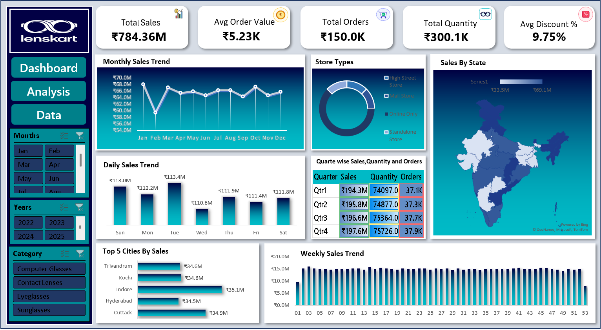

# Lenskart Omnichannel Sales & Operations Dashboard

An executive-level Retail Business Intelligence dashboard that analyzes **150,000+ omnichannel transactions** across India. Built entirely in Microsoft Excel using Pivot Tables, dynamic calculated KPIs, custom number formatting and interactive slicers.

## Dashboard Preview



## Business Problem

Retail leadership needed one dashboard to:
- Track overall sales, orders, units and average order value
- Compare online and offline (physical store) performance
- Understand geographic reach across states and cities
- Review category mix and sales cadence by day of week

## Key KPIs

| KPI | Value |
|---|---|
| Total Net Sales | ₹784.36M (across 23 cities) |
| Total Order Volume | 150,000 transactions |
| Total Units Sold | 300,064 units (avg 2.0 items per basket) |
| Average Order Value (AOV) | ₹5,229 |
| Average Discount Rate | 9.75% |

## Key Business Insights

1. **Omnichannel Store Performance:** Online accounted for ~50.1% of volume, while offline physical stores (Mall Stores, High Street, Standalone) delivered 49.9%, showing effective omnichannel penetration.
2. **Geographical Reach:** Pan-India footprint across 16 states and 23 cities, with high sales in hubs including Indore, Cuttack, Kochi, Trivandrum and Hyderabad.
3. **Category Balance:** Revenue is split almost evenly across Eyeglasses (25.2%), Contact Lenses (25.0%), Sunglasses (24.9%) and Computer Glasses (24.9%).
4. **Sales Cadence:** Day-of-week sales are stable at about ₹111M to ₹113M per day, with consistent order placement on both working days and weekends.

## Visuals

- Sales by channel (Online vs Offline store formats)
- Sales by city and state
- Sales by product category
- Sales by day of week

## Filters

Year | Sales Channel | Product Category | Geography

Connected slicers cross-filter the whole dashboard.

## Data Model

- 150,000+ transaction-level omnichannel sales records
- Pivot Tables as the calculation backend, with calculated fields for dynamic aggregations
- Multi-level row grouping and custom summary calculations

## Key Learnings and Approach

- Built dynamic KPIs using Pivot Tables and calculated fields
- Applied custom number formatting for clean metric display: `₹#,##0.00,,"M"` for millions, `#,##0.0,"K"` for thousands, and fixed percentages
- Connected slicers across multiple pivots for cross-filtering
- Designed the UI with a custom palette (Lenskart Navy `#000042` and Teal `#00BAC6`), soft card containers, icons and no gridlines

## Tools Used

Microsoft Excel, Pivot Tables, Calculated Fields, Slicers, Custom Number Formatting

## Repository Structure

```
├── README.md
├── Lenskart_Dashboard_Project.xlsx   # Excel workbook (Pivots + Dashboard)
└── Lenskart_Dashboard.png            # Dashboard screenshot
```

## How to Use

1. Download `Lenskart_Dashboard_Project.xlsx`
2. Open it in Microsoft Excel
3. Use the Year, Sales Channel, Product Category and Geography slicers to explore the data

## Author

**Vikas Pawar**
🔗 [LinkedIn](https://www.linkedin.com/in/vikas-pawar-in) | [GitHub](https://github.com/Viky3891)

Feedback and suggestions are welcome!
